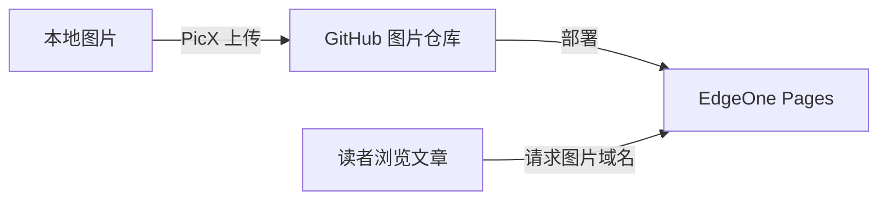

最近整理刚写完的系列文章时，我开始认真考虑图片的存放问题。

历史文章里有不少地图、人物肖像和战地照片。写作时直接引用原站图片很方便，但读文章时，有些图片加载缓慢，偶尔还会无法显示。随着图片越来越多，哪些图片属于哪篇文章、替换后旧图是否还需要保留，也逐渐变成了需要管理的事情。

于是，我决定把这批图片先备份到本地，再上传到自己的图床，通过统一的图片域名提供访问。这篇文章记录的，就是从搭建图床到完成图片引用替换的过程。

# 最初考虑过的两条路

## 本地随站点构建，还是使用独立图床

最开始，我考虑过把图片全部下载下来，直接放进博客项目，和文章一起构建、发布。

这个办法很直观：文章和图片在同一个项目里，查找、备份也方便。这里说的“本地”，指的是把图片作为网站资源一同部署，读者最终访问的仍然是线上文件。

不过，历史文章里的图片还会继续增加，我也会不时补图、换图。我更希望这些图片有独立的管理目录和发布流程，让博客仓库主要保存文章、配置和组件。

而且我的源站带宽也不大，如果全部回源拉取图片，体验可能未必比直链好多少。

| 比较项 | 图片随博客构建 | 图片放在独立图床 |
| --- | --- | --- |
| 文件管理 | 文章和图片集中在同一个项目 | 博客与图片分开管理，需要维护对应关系 |
| 仓库体积 | 图片及其版本记录会增加博客仓库体积 | 图片体积转移到独立仓库，博客仓库更轻 |
| 构建与发布 | 图片作为站点产物一起处理、部署 | 图片项目单独部署；使用新链接时仍需更新并发布文章 |
| 图片处理 | 可接入 Astro 的图片优化流程 | 我在上传时通过 PicX 处理，再使用实际生成的链接 |
| 离线备份 | 一份完整项目可包含文章和图片 | 需要分别保留文章与图片副本 |

本地图片的构建开销也取决于用法。以 Astro 为例，放在 `public/` 的文件直接复制到输出目录；放在 `src/` 并接入图片处理流程的资源，可以参与优化，处理结果也能利用缓存。不能把所有本地图片都理解成“每次构建都要重新压缩一遍”。具体行为见 [Astro 图片指南](https://docs.astro.build/en/guides/images/)。

## GitHub Pages，还是 EdgeOne Pages

决定使用独立图床后，另一个很自然的选择是 GitHub Pages：图片已经由 PicX 上传到 GitHub，PicX 又提供了一键部署入口，接起来很方便。我确实考虑过直接采用这条路线。

GitHub Pages 能从仓库发布静态资源，也支持[自定义域名](https://docs.github.com/en/pages/configuring-a-custom-domain-for-your-github-pages-site/about-custom-domains-and-github-pages)。两种方案的区别，主要在于由谁部署和提供访问：

| 比较项 | GitHub Pages | EdgeOne Pages |
| --- | --- | --- |
| 图片文件来源 | 使用 GitHub 图片仓库 | 同样可以使用这个 GitHub 图片仓库 |
| 接入方式 | 可沿用 PicX 的一键部署入口 | 授权导入仓库，再配置项目 |
| 更新发布 | 由 Pages 发布流程更新站点 | 仓库更新后由 EdgeOne 的部署流程发布 |
| 访问与区域 | 使用 GitHub Pages 的托管网络，效果需要实际测试 | 可按项目选择加速区域，再测试实际效果 |
| 图片域名 | 可以绑定自定义域名 | 可以绑定自定义域名，并关联生产环境 |
| 日常维护 | 主要在 GitHub 查看发布状态和相关设置 | 在 EdgeOne 控制台管理部署、域名与加速区域 |

最终，我放弃了 GitHub Pages，选择把同一个图片仓库交给 EdgeOne 部署。我已经在使用腾讯云，网站也通过了备案，这样不仅管理方便，还可以选用中国大陆加速，提供相当不错的访问速度。[EdgeOne 的域名与区域说明](https://pages.edgeone.ai/document/domain-overview)列出了不同区域及其配置要求。

# 图片放在哪里，链接又从哪里来

最终采用的组合是 **PicX + GitHub + EdgeOne Pages**。

它们分别承担不同的工作：

| 组成 | 在这套方案中的作用 |
| --- | --- |
| PicX | 上传、整理图片，并复制图片链接 |
| GitHub 仓库 | 保存上传后的图片文件 |
| EdgeOne Pages | 部署仓库里的静态图片资源 |
| 自定义图片域名 | 为文章提供统一的访问地址 |

访问关系可以画成下面这样：



[PicX 的 GitHub 图床](https://github.com/XPoet/picx#github-图床)支持目录管理、批量操作和图片链接复制。我需要的主要就是这部分功能。

图片有了独立域名后，博客文章和图片资源可以分别维护，以后调整托管方式时，也有机会通过域名保持访问入口稳定。

> [!NOTE]
> 下文沿用 EdgeOne Pages 这一称呼。目前部分[官方文档](https://pages.edgeone.ai/document/build-guide)已使用 EdgeOne Makers，查看时可能会遇到不同名称。

# 先传一张测试图片

没错，就是这篇文章的封面图！

先用一张图片走完上传、部署、域名访问和文章引用的流程，确认每一步都能正常工作，再处理整批图片，会容易排查得多。

## 准备账号和图片域名

开始之前，需要准备一个 GitHub 账号、一个腾讯云账号，以及一个可以管理 DNS 解析的域名。我给图片单独分配了子域名 `img.nightbugclub.cn`。

加速区域也需要提前想好。如果使用“中国大陆”或“全球可用区（含中国大陆）”，接入的自定义域名需要满足 ICP 备案要求；没有备案域名时，可以考虑“全球可用区（不含中国大陆）”。我已有备案，因此选择了包含中国大陆的区域，具体区别见 [EdgeOne 加速区域说明](https://pages.edgeone.ai/document/domain-overview)。

## 登录 PicX，上传封面

进入 [PicX](https://picx.xpoet.cn/) 的 GitHub 图床功能。这里以 PicX v3 的 GitHub OAuth 登录流程为例：

1. 在登录页点击“安装 PicX GitHub APP”，跳转到 GitHub 完成安装。
2. 返回 PicX，点击“GitHub OAuth 授权登录”，完成授权。
3. 登录成功后，检查自动完成的图床配置。

PicX v3 默认使用仓库 `picx-images-hosting` 和分支 `master`，配置时会自动创建所需仓库。已有其他版本的配置时，应以自己界面中的实际信息为准。登录与初始化过程可对照 [PicX 快速开始](https://picx-docs.xpoet.cn/usage-guide/get-start.html)。

接下来，在“图床配置”中设置保存目录。我把这张封面放在 `posts/test`，可以通过新建目录输入这个路径；多级目录用 `/` 分隔。目录的几种设置方式见 [PicX 图床配置](https://picx-docs.xpoet.cn/usage-guide/config.html)。

切换到“上传图片”，选择封面，检查上传目录和图片处理选项，再点击上传。测试阶段先传这一张就够了。

上传成功后，在“图床管理”中找到图片，再打开 GitHub 上的 `picx-images-hosting` 仓库，切换到 `master` 分支，进入 `posts/test`，确认文件已经出现。到这里，先记下三件事：**仓库名称、分支名称、文件在仓库中的完整路径**。

这篇文章封面上传后的实际文件名是：

```text
f3c08ec596129347ef057118aeabf4a61334156f.jpg@672w_378h_1c_!web-search-common-cover.46h65a4rl.webp
```

名字虽然很长，但后面不需要手动重写它。PicX 的哈希化、压缩设置可能改变最终名称和格式，访问时认准仓库中真正存在的文件即可。相关选项见 [PicX 上传说明](https://picx-docs.xpoet.cn/usage-guide/upload.html)。

PicX 中还提供了“一键部署 GitHub Pages”的入口。看到它时不用急着点击：这次图片由 EdgeOne Pages 部署，上传到 GitHub 后，就可以接着配置 EdgeOne。

## 在 EdgeOne 中导入图片仓库

登录腾讯云，进入 EdgeOne Pages 的项目列表，新建项目，选择通过 Git 仓库导入。首次使用时，需要关联 GitHub，并授权 EdgeOne 读取准备部署的仓库。

在仓库列表中选择 `picx-images-hosting`。如果列表中看不到它，先检查 GitHub 授权是否包含这个仓库，再刷新列表。连接与授权流程见 [EdgeOne 导入 Git 仓库指南](https://pages.edgeone.ai/document/importing-a-git-repository)。

项目名称可以沿用 `picx-images-hosting`，生产分支选择 PicX 实际上传的 `master`，加速区域选择前面确定的区域。这里部署的是图片仓库，博客项目有自己的部署流程。

## 展开构建设置，发布仓库里的静态文件

图片已经是可以直接访问的文件，这个项目不需要执行 Astro 构建。下面给出适用于纯图片仓库的一组配置方式：

| 配置项 | 填写内容 | 原因 |
| --- | --- | --- |
| 框架预设 | `Other` | 按普通静态资源处理 |
| 根目录 | 仓库根目录，使用默认的 `./` | 图片目录位于仓库中 |
| 安装命令 | `echo "Skip install"` | 只输出提示，跳过无关的依赖安装 |
| 构建命令 | `echo "Static images only"` | 只输出提示，无需编译图片 |
| 输出目录 | `./`，即仓库根目录；若界面使用目录选择器，则选择根目录 | 发布仓库中的图片目录 |
| 环境变量 | 无需添加 | 这套静态图片访问流程不需要额外变量 |

两条 `echo` 命令只是明确地让对应步骤输出一行提示。如果界面提供直接跳过安装或构建的选项，也可以使用该选项。平台支持 Bash 构建命令，根目录与输出目录的含义见 [EdgeOne 构建指南](https://pages.edgeone.ai/document/build-guide)。

输出目录最容易填错。假如仓库的结构是这样：

```text
picx-images-hosting/
└── posts/
    ├── test/
    │   └── 封面图片.webp
    └── history/
        └── 某篇文章/
            └── 图片.webp
```

选择仓库根目录作为输出目录，发布后的图片路径就保留 `posts/test/` 和 `posts/history/`。如果只输出 `posts/test`，发布范围和访问路径都会随之改变；如果填写 `dist`，仓库中又没有生成这个目录，就无法按预期发布图片。

检查完配置，点击“开始部署”。在部署详情中确认状态成功、分支为 `master`，并且所用提交已经包含测试图片。若部署失败，先查看日志中失败的步骤，再检查对应配置。

**PicX 上传成功，只表示文件已经进入 GitHub；EdgeOne 部署成功，才表示这一版文件已经发布。** 后续每次上传新图，都要留意这两个阶段。

## 绑定图片域名，配置 DNS 和 HTTPS

部署完成后，进入这个项目的“域名管理”，添加自己的图片子域名。我这里填写 `img.nightbugclub.cn`，并将它关联到**生产环境**。

随后按照控制台引导完成域名归属验证。若要求添加验证记录，就到域名当前使用的 DNS 服务商处添加对应记录，再回到 EdgeOne 验证。域名归属验证和图片访问所需的解析各有用途，分别照控制台给出的内容操作。

访问解析使用 EdgeOne 提供的 CNAME 目标。以在 `nightbugclub.cn` 的 DNS 区域内添加图片子域名为例：

| DNS 配置项 | 填写内容 |
| --- | --- |
| 主机记录 | `img` |
| 记录类型 | `CNAME` |
| 记录值 | EdgeOne 为这个自定义域名提供的 CNAME 目标，原样复制 |
| 线路与 TTL | 首次配置可使用 DNS 控制台默认值 |

记录值填写目标域名，不添加 `https://` 或图片目录。同一个 `img` 主机名若已有冲突的解析记录，需要先确认旧用途，再调整。完成后等待 DNS 生效，返回 EdgeOne 检查解析状态。添加域名、归属验证和环境关联可对照 [EdgeOne 自定义域名说明](https://pages.edgeone.ai/document/custom-domain)。

接着打开该域名的 HTTPS 配置。没有现成证书时，可以使用平台的免费证书申请功能；已有证书时，也可以按支持的方式部署托管证书。确认申请和部署完成后，再使用 `https://` 测试图片，具体操作见 [EdgeOne HTTPS 配置说明](https://pages.edgeone.ai/zh/document/configuring-an-https-certificate)。

到这里，应该分别确认三件事：DNS 已指向平台、自定义域名关联生产环境、HTTPS 证书已经生效。后续生产分支的新版本部署成功后，这个图片域名就可以继续作为固定入口。

## 找到真实文件路径，打开封面链接

图片地址由两部分组成：

```text
图片域名 + 文件相对于部署输出目录的路径
```

回到 GitHub，在 `master` 分支找到封面文件。复制文件路径时，取的是仓库内从 `posts/` 开始的路径；GitHub 文件页面地址中的账号、仓库名和 `blob/master` 都不属于部署后的图片路径。

由于这里把仓库根目录作为输出目录，封面的完整路径为：

```text
posts/test/f3c08ec596129347ef057118aeabf4a61334156f.jpg@672w_378h_1c_!web-search-common-cover.46h65a4rl.webp
```

在前面加上图片域名，就得到这篇文章实际使用的封面地址：

```text
https://img.nightbugclub.cn/posts/test/f3c08ec596129347ef057118aeabf4a61334156f.jpg@672w_378h_1c_!web-search-common-cover.46h65a4rl.webp
```

把完整地址粘贴到浏览器新标签页，能够直接显示封面，就说明这条访问路径已经跑通。仓库名 `picx-images-hosting` 不需要再加到域名后面。

测试时打开的是**具体图片地址**。纯图片仓库没有准备首页时，直接访问 `https://img.nightbugclub.cn/` 可能返回 404，这本身不能说明图片部署失败。

如果具体图片仍然 404，先核对文件名和目录是否一致，再看最新生产部署是否已经包含该文件，以及输出目录是否改变了路径。后文那八张含单引号的图片，是在这些基础检查都完成后才进一步定位到的问题。

## 回到 PicX，让复制的链接使用自己的域名

图片可以访问后，还需要补上日常使用的一步：让 PicX 直接生成自己的域名链接。

在 PicX 的“我的设置”中找到“图片链接规则配置”，展开“配置自定义图片链接规则”，添加一条规则。例如，类型填写 `EdgeOne`，规则填写：

```text
https://img.nightbugclub.cn/{{path}}
```

这里的 `{{path}}` 是 PicX 的文件路径占位符，保留双层大括号，PicX 会把它替换成包含目录和文件名的实际路径。读者配置时，把域名换成自己的即可。规则入口和占位符示例见 [PicX 自定义图片链接规则](https://picx-docs.xpoet.cn/usage-guide/settings.html#配置自定义图片链接规则)。

添加以后，还要在“选择图片链接规则”的下拉框中选中刚才的 `EdgeOne`。回到图床管理，复制封面的链接，检查它是否与前面手动拼出的地址一致。

链接格式可以根据用途选择：平时写 Markdown 正文，可以开启自动转换为 Markdown；需要填写文章封面字段，或者导出链接清单用于迁移时，则使用纯 URL。

例如，这张图放进 Markdown 正文时写成：

```markdown

```

修改 PicX 链接规则影响的是后续复制出来的地址，已经写进文章的旧链接仍需要另外替换。

## 再上传一张图，确认后续能自动更新

最后，可以换一张不同文件名的图片，再走一遍日常操作：在 PicX 上传，确认 GitHub 出现新提交，然后到 EdgeOne 查看是否自动触发了新的生产部署。

Git 集成的自动部署开启后，生产分支的提交会触发更新；若没有新部署记录，检查仓库、生产分支与自动部署设置，也可以从控制台手动重新部署。更新机制见 [EdgeOne Git 部署指南](https://pages.edgeone.ai/document/importing-a-git-repository)。

等部署成功，再复制自己的域名链接，打开验证，最后写入文章并发布博客。首次配置完成后，后续就沿着这条路线操作：

```text
PicX 上传 → GitHub 仓库更新 → EdgeOne 部署成功 → 验证图片链接 → 在文章中使用
```

我也是确认单张图片能够正常访问以后，才开始处理整批文章。

# 把文章中的图片搬过去

这批图片按文章整理，本地目录与文章目录保持对应：

```text
文章：history/WWI/某篇文章.md
原图：images/history/WWI/某篇文章/图片文件.jpg
图床：posts/history/WWI/某篇文章/上传后的图片.webp
```

这样，在 PicX 里查找图片、给某篇文章补图，都会比较直观。

实际迁移流程是：先下载并备份原图，按文章整理，再通过 PicX 上传；等 EdgeOne 部署完成，取得新链接，最后备份文章并替换图片地址。原有的图注、作者、来源页面和许可说明继续保留。

为了减少重复操作，我另外准备了一个小工具，辅助扫描、下载、匹配和替换。

匹配时，每个原图地址在清单中对应一个编号，下载后的文件名保留这个编号。因此，即使上传后添加了后缀、转换了格式，仍能从图床文件名找到对应图片。文章里的图注不需要改成新文件名，替换的是图片 URL。

# 批量下载先遇到了 429

文章中的不少图片来自 Wikimedia Commons。开始批量下载后，很快遇到了 `HTTP 429 Too Many Requests`，部分响应还要求等待 600 秒。

排查时，我找到了 [Wikimedia 的 User-Agent 政策](https://foundation.wikimedia.org/wiki/Policy:Wikimedia_Foundation_User-Agent_Policy/zh)。它要求自动化客户端明确表明身份，提供可识别的程序信息和联系渠道。

于是，下载请求开始使用包含程序名、版本和联系地址的 User-Agent，例如下面这种形式：

```text
ExampleImageMigratorBot/1.0 (https://example.com/contact)
```

同时，我把下载控制为单线程、请求间隔约 5 秒，总下载限速约 1 MB/s，并继续复用已经下载好的文件。

调整后，429 明显减少了。但这不能只归功于 User-Agent：请求频率、带宽和缓存复用也一起发生了变化。表明身份更不等于登录认证或获得限流豁免。收到 429 时，仍应遵守源站的 `Retry-After` 等要求，相关规则见 [Wikimedia Robot policy](https://wikitech.wikimedia.org/wiki/Robot_policy)。

# 最后一张 SVG，问题出在识别逻辑

下载接近完成时，只剩一张 SVG 图片始终下载失败。

检查后发现，文件本身能够读取，只是在 XML 声明后还带有 `DOCTYPE`。原来的识别逻辑没有完整处理这类文件头，导致合法的 SVG 没有通过检查。

SVG 文件不一定直接以 `<svg>` 开头，例如：

```xml
<?xml version="1.0"?>
<!DOCTYPE svg>
<svg xmlns="http://www.w3.org/2000/svg">...</svg>
```

补全识别逻辑后，这张图成功保存，原始文件内容也保持不变。这个问题提醒我，下载失败有时发生在客户端自己的检查步骤里，需要把响应状态、实际内容和识别结果分开看。

# 固定八张图片为什么总是 404

上传完成后，最费解的问题出现了：大部分图片都正常，偏偏固定几张始终无法通过 EdgeOne 访问。重新上传以后，问题仍然存在。

把失败的文件名放在一起看，终于发现共同点：它们都包含英文单引号 `'`，例如 `l'Armée`、`d'assalto` 和 `'75'`。

随后，对同一批文件做了对照：

| 测试方式 | 结果 |
| --- | --- |
| 直接读取 GitHub 上的图片文件 | 正常返回图片 |
| 访问 EdgeOne 对应路径 | 返回 404 |
| 把单引号编码成 `%27` 后访问 | 仍返回 404 |
| 去掉单引号，重新上传并部署 | 正常返回图片 |

这个结果很明确地把问题缩小到了含单引号的资源路径上。

不过，**单引号本身是合法的 URL 路径字符**，[RFC 3986](https://datatracker.ietf.org/doc/html/rfc3986#section-3.3)允许它出现在路径中。因此，不能把这次经历直接写成“所有图床都不支持单引号”。

根据实测，更可能是当前 EdgeOne 部署链路在处理这类路径时存在兼容性问题。具体发生在文件索引、转义解码还是其他环节，仅凭这些响应还无法确定。

对我的博客而言，先采用已经验证有效的处理方式就足够了：上传前去掉文件名中的英文单引号，保留其余名称和匹配编号。

# 后续维护

以后新增图片时，我会先保存本地副本，放进对应文章的目录，处理文件名，再上传 PicX，等 EdgeOne 部署完成后使用实际链接。

更换图片时，使用新文件名和新链接，确认文章显示正常后再整理旧图。如果本地同步提示某张图已不再被文章引用，也会先看清待删除清单；图床上的删除则另外确认，不把两件事混在一起。

这次整理以后，图片有了本地备份，文章里的资源也有了统一的访问入口。下一篇文章再需要配图时，就可以沿着这套已经跑通的流程继续添加了。
